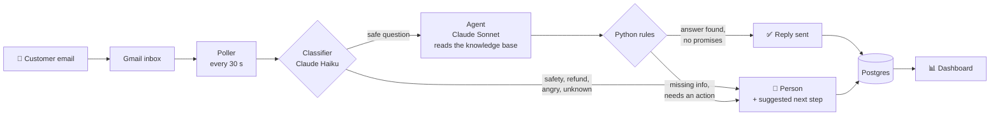

# ⚡ AI Customer Support

**An AI that answers customer emails for an e-bike shop in seconds, and knows when to hand one to a person.**

[](docs/media/support-walkthrough.mp4)

<sub>The dashboard in sample-data mode, shown at 2× speed. [Full video (1:33, MP4)](docs/media/support-walkthrough.mp4)</sub>


---

## What it does

A customer writes to the shop's Gmail. Within about a minute they get a correct, friendly reply, in English or Hebrew, written only from the shop's own knowledge base.

When it shouldn't answer (a swollen battery, a refund, an angry customer, a question nobody has written an answer for), the AI sends a short holding reply and passes the email to a person with a suggested next step.

The team runs everything from a dashboard: see what the AI did and why, reply to tickets, edit what the AI knows, and test it on any email before a customer ever sends one.

## Highlights

- **Answers in seconds**, around the clock, in the customer's language
- **Never guesses:** answers only from the knowledge base and escalates the rest
- **Shows its reasoning:** every decision is logged with the knowledge it used
- **Finds its own blind spots:** questions it couldn't answer are grouped on a *Knowledge gaps* page, ready to fill in
- **Try before you trust:** paste any email and watch each step of the decision, without sending anything
- **Tested against 23 hand-written emails** (English and Hebrew), so a prompt change can't quietly break it

## How it works



**The model proposes, Python decides.** The AI fills in a typed form (Pydantic): topic, language, "is this a safety issue?", "does the knowledge base answer it?", "does my reply promise anything?". Plain Python code then makes the final call. Rules that must never bend don't rely on a prompt:

- A battery safety message is fixed text, never written by the model.
- A reply that promises a refund, a shipment or a date goes to a person.
- Emails with attachments, legal questions and attempts to give the AI new instructions are always escalated.

## Tech stack

| Layer | Technology |
|---|---|
| **AI** | Claude (Haiku to triage, Sonnet to write) via [Pydantic AI](https://ai.pydantic.dev), structured outputs, tool calls into the knowledge base |
| **Backend** | Python 3.13, FastAPI, psycopg 3, uv |
| **Email** | Gmail API (OAuth): polling, threaded replies, labels as state |
| **Database** | Supabase Postgres, with SQL migrations |
| **Dashboard** | React 19, TypeScript, Vite, Tailwind CSS 4, shadcn/ui, TanStack Query, React Router |
| **Quality** | pydantic-evals (golden email set), Vitest, ESLint, strict TypeScript |
| **Deploy** | Docker multi-stage build, Docker Compose (API + poller), Linux VPS |

## Under the hood

**Reliable email handling**
- Every Gmail message is claimed once in the database (`unique` on its id), so no email gets two replies, even after a crash or restart.
- Failed emails are retried up to 3 times, then labelled and left for a person.
- Auto-replies, newsletters and the shop's own mail are skipped, so it never loops with another bot.
- A `needs-human` Gmail label keeps the AI out of a thread until a person resolves it.

**A dashboard built for daily use**
- Live data with TanStack Query: lists refresh on their own and actions update every view.
- Statistics are computed in SQL, so the numbers stay correct as the inbox grows.
- Filters live in the URL (shareable links), unsent replies are kept per ticket, and every page has loading, empty and error states.
- Light and dark themes, keyboard shortcuts, and layouts that work on a phone.
- A **sample-data mode** runs the whole dashboard in the browser with invented customers, which is how the video above was recorded.

## Security

The idea: **close everything, then open one door, for one person, with one key.**

| Layer | What's in place |
|---|---|
| **Network** | The API has no public port: it listens on `localhost` only. The dashboard is reached through an SSH tunnel, so traffic is encrypted and only someone with the SSH key gets in. |
| **Server** | Firewall allows SSH from one IP only, key-based login, no root login, and a read-only deploy key for GitHub. |
| **App login** | HTTP Basic auth on every API route as a second lock, compared in constant time. |
| **Database** | IP allow list (laptop and server only) and row-level security switched on with no public policies, so Supabase's public API returns nothing. |
| **Secrets** | Kept in `.env`: never in Git and never in the Docker image. Rotation steps are written down in [SECURITY_NOTES.md](SECURITY_NOTES.md). |
| **The AI** | Answers only from the knowledge base, never mentions internal tools, escalates prompt-injection attempts, and Python rules overrule the model where it matters. |
| **Input** | Every API input is validated (lengths, allowed values) with Pydantic. |

## Project structure

```
app/
  ai/              classifier, agent, rules, and the decide() pipeline
  pipeline.py      one email: guards -> AI -> reply -> save
  poller.py        checks Gmail every 30 seconds
  main.py          the API the dashboard uses
dashboard/         React + TypeScript dashboard
knowledge_base/    what the AI knows, as Markdown
evals/             23 golden emails and the evaluation runner
supabase/          database migrations
scripts/           Gmail setup, knowledge base and mock-data seeding
```

## Run it locally

You'll need Python 3.13, [uv](https://docs.astral.sh/uv/) and Node 22.

```bash
uv sync && cp .env.example .env              # add your keys
uv run fastapi dev app/main.py               # API on :8000

cd dashboard && npm install && npm run dev   # dashboard on :5173
```

No keys at hand? Open the dashboard and click **Explore with sample data**.

```bash
uv run python -m evals.run_evals    # run the AI against the golden emails
cd dashboard && npm test            # unit tests
```

---

<sub>Day-to-day operations are in [HOW_TO_USE.md](HOW_TO_USE.md) · Security details are in [SECURITY_NOTES.md](SECURITY_NOTES.md)</sub>
